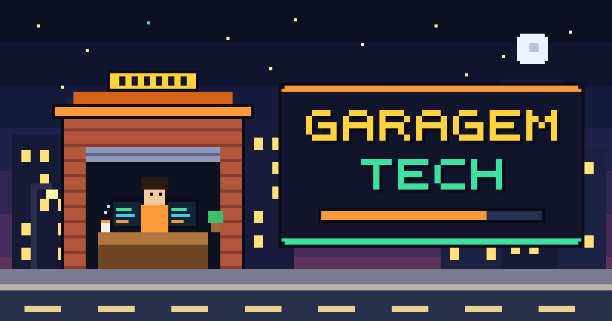

# Garagem Tech



**Garagem Tech** é um jogo *idle/tycoon* brasileiro em pixel art feito para rodar direto no navegador ou instalado como aplicativo (PWA), com suporte offline completo.

Tudo começa numa garagem simples, com um notebook antigo e uma xícara de café. A partir daí, você escreve código, lança aplicativos, contrata desenvolvedores, monta setores inteiros, expande sua operação pelo mundo, abre capital na bolsa (IPO), desce pelos andares subterrâneos para enfrentar IAs rebeldes e leva sua empresa até as estrelas.

---

## Principais sistemas

- **Cena viva em pixel art (`<canvas>`)**: o cenário evolui da garagem até um arranha-céu corporativo com vários andares, elevador funcional, ciclo de dia/tarde/noite, clima sazonal, visitantes, bugs correndo pelo chão e estrelas turbo.
- **Progressão profunda**:
  - **8 tipos de aplicativos** e **8 cargos de equipe** com bônus em marcos de nível (`10`, `25`, `50` e `100`).
  - **Equipamentos**, **Departamentos**, **Árvore de Pesquisas** e **Especializações** permanentes (*Magnata*, *Engenheiro*, *Visionário* e *Empreendedor*).
  - **Expansão Internacional** em mapa-múndi interativo com 20 mercados.
  - **Sistema de IPO** (até 50 aberturas de capital) com histórico, marcos e coleções.
  - **Nova Era**: colonização espacial do Sistema Solar até a Rede Galáctica e **Ascensão Cósmica**.
- **Subterrâneos e Chefões**:
  - **Subterrâneo 1 — Mr. Malware**: 5 minigames de terminal para restaurar os servidores.
  - **Subterrâneo 2 — Dr. Lucas**: duelo de fases rápidas e captura para a sua equipe.
  - **Subterrâneo 3 — SKYNET-X & revanche MK2**: combate contra superinteligência com cenas animadas.
  - **Subterrâneo 4 — NULL-Ø**: entidade dimensional com 7 mecânicas inéditas em canvas (*Desvio*, *Decifrar*, *Órbita*, *Encaixe*, *Corte*, *Sintonia* e *Traço*) e forma final.
- **Customização e Mascotes**: editor completo de personagem, emblema pixelado da empresa, roupas, acessórios e mascotes colecionáveis que seguem você pela cena.
- **Online opcional**: ranking global, sistema de amizades com presença online, visitas ao escritório de outros jogadores, código de convite e salvamento na nuvem via Supabase.
- **Áudio retrô procedural**: efeitos sonoros e trilha chiptune em múltiplas vozes sintetizados em tempo real via Web Audio API, sem arquivos externos pesados.

---

## Atalhos no computador

| Tecla | Ação |
| :--- | :--- |
| `Espaço` ou `Enter` | Programar (gerar código e acumular combo) |
| `H` | Ativar Hackathon (quando disponível) |
| `1` – `4` | Alternar entre Início, Equipe, Troféus e Ranking |
| `5` ou `M` | Abrir / fechar a Central da Empresa (*Mais*) |
| `Esc` | Fechar janelas e menus abertos |

---

## Como rodar localmente

O projeto não exige etapa de build nem dependências externas — basta servir a pasta com qualquer servidor HTTP estático (necessário para o Service Worker do PWA funcionar):

```bash
python3 -m http.server 8000
```

Depois, acesse `http://localhost:8000` no navegador.

---

## Estrutura do projeto

- `index.html` — Jogo completo (interface, estilos em pixel art, sprites autorais, áudio Web Audio API e lógica).
- `sw.js` — Service Worker com cache offline da aplicação.
- `manifest.webmanifest` — Manifesto Web App para instalação no celular ou desktop.
- `favicon.png`, `icon-192.png`, `icon-512.png` — Ícones em pixel art da garagem.
- `og-cover.png` — Arte de divulgação para compartilhamento em redes sociais (Open Graph).
